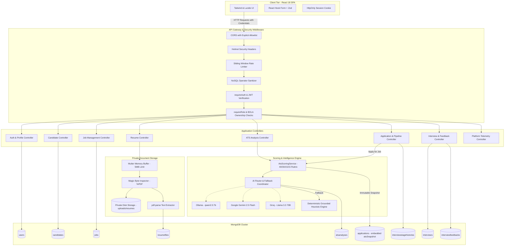

# EarlyAI ATS — Intelligent Applicant Tracking System

[](https://www.typescriptlang.org/)
[](https://react.dev/)
[](https://vitejs.dev/)
[](https://nodejs.org/)
[](https://expressjs.com/)
[](https://www.mongodb.com/)
[](https://tailwindcss.com/)
[](https://vitest.dev/)
[](https://opensource.org/licenses/ISC)

> **EarlyAI ATS** is a modern, full-stack Applicant Tracking System engineered for high-velocity recruiting teams and candidates alike. It blends role-based hiring workflows, visual pipeline management, and multi-provider AI resume evaluation with strict security boundaries, mathematically grounded rubrics, and offline fallback capabilities.

---

## 📑 Table of Contents

- [Key Capabilities](#key-capabilities)
- [Role-Based Portals](#role-based-portals)
- [System Architecture](#system-architecture)
- [Technology Stack](#technology-stack)
- [Repository Structure](#repository-structure)
- [Getting Started & Execution Guide](#getting-started--execution-guide)
  - [1. Prerequisites](#1-prerequisites)
  - [2. Installation & Setup](#2-step-by-step-installation--setup)
  - [3. Start MongoDB Database](#3-start-mongodb-database)
  - [4. Run the Development Servers](#4-run-the-development-servers)
  - [5. Verify Service Health](#5-verify-service-health)
  - [6. First-Time Walkthrough & Role Access](#6-first-time-walkthrough--role-access)
  - [7. Production Build & Execution](#7-production-build--execution)
  - [8. All Monorepo Commands Reference](#8-all-monorepo-commands-reference)
  - [9. Troubleshooting & FAQ](#9-troubleshooting--faq)
- [AI Engine & Offline Development](#ai-engine--offline-development)
- [Security & Data Integrity Guardrails](#security--data-integrity-guardrails)
- [API Reference](#api-reference)
- [Quality Assurance & Verification](#quality-assurance--verification)
- [Production Deployment Notes](#production-deployment-notes)
- [License](#license)

---

## 🌟 Key Capabilities

- **👥 Multi-Role Workspaces:** Dedicated, purpose-built interfaces for **Candidates**, **Hiring Teams (Recruiters & Hiring Managers)**, and **Platform Administrators**.
- **🤖 Grounded Multi-Model AI Evaluation:** Integrates local Ollama (`qwen2.5:7b`), Google Gemini (`gemini-2.5-flash`), and Groq (`llama-3.3-70b-versatile`), with an automatic deterministic heuristic engine for 100% offline, zero-dependency development.
- **📊 4-Part Weighted Scoring Rubric:** Objective candidate-to-job matching computed strictly against:
  - **Skills Match:** 40%
  - **Experience Relevance:** 30%
  - **Education & Credentials:** 15%
  - **Role & Domain Alignment:** 15%
- **🔒 Security by Design:**
  - Token-authenticated sessions delivered via `HttpOnly`, `SameSite` cookies (XSS-proof).
  - Fine-grained server-side Role-Based Access Control (RBAC) and Broken Object-Level Authorization (BOLA) defenses.
  - `<resume_content>` XML isolation mitigating prompt injection risks.
  - Magic-byte validation (`%PDF`, `PK\x03\x04`), SHA-256 deduplication, and obfuscated private disk storage.
  - In-memory sliding-window IP rate limiting and recursive NoSQL operator sanitization.
- **📑 Immutable Application Snapshots:** When a candidate applies, their ATS score breakdown and rubric report are immutably snapshotted into the application record, preserving audit integrity even if the candidate later deletes or updates their resume.
- **🚀 Visual Kanban Pipeline:** Drag-and-drop recruitment stage progression (`Applied` ➔ `Screening` ➔ `Interview` ➔ `Offer` ➔ `Hired` / `Rejected`) enforcing legal state transitions and historical change auditing.
- **📅 Interview Scheduling & Feedback Controls:** Integrated interview management with meeting links and stage review governance; interviewer notes and evaluation feedback remain confidential until explicitly approved and released to candidates.
- **📈 Real-Time Recruitment Analytics:** Visual metrics for pipeline conversion rates, stage velocity, average time-to-hire, and drop-off analysis powered by Recharts.

---

## 👥 Role-Based Portals

EarlyAI ATS provides tailored workflows configured through role-aware navigation and route guards:

| Portal | Target Audience | Primary Features |
| :--- | :--- | :--- |
| **Candidate Portal**<br>`/candidate` | Job Seekers & Applicants | • Profile and contact information management<br>• PDF resume upload with selectable text extraction<br>• Real-time ATS match scoring against active job openings<br>• 1-Click job application with immutable ATS snapshot lock<br>• Application status tracking and scheduled interview calendar<br>• Released interview feedback review |
| **Recruiter & Hiring Team Portal**<br>`/overview`, `/pipeline`, `/jobs`, `/candidates` | Recruiters & Hiring Managers | • Multi-stage recruitment Kanban pipeline<br>• Strict stage transition state machine enforcement<br>• Job requisition lifecycle (create, edit, archive, salary ranges)<br>• Candidate directory with instant search and resume preview drawer<br>• 4-Part ATS scorecard review and matched/missing keyword audit<br>• Interview scheduling with Google Meet links<br>• Internal confidential evaluator notes and controlled feedback release<br>• Funnel analytics, time-to-hire, and stage distribution charts |
| **Platform Manager Portal**<br>`/platform` | System Administrators | • System environment telemetry and active service health<br>• Dynamic AI provider routing and latency monitoring<br>• User governance, role auditing, and privilege escalation guards<br>• Platform logs and diagnostic benchmarks |

---

## 🏗 System Architecture

The following diagram illustrates the end-to-end data flow from client requests through security middleware, domain controllers, the AI scoring engine, and persistent storage:



---

## 🛠 Technology Stack

### Frontend (`apps/web`)
- **Framework:** React 18 with TypeScript 5
- **Build Tool:** Vite 6
- **Styling:** Tailwind CSS 3 with PostCSS and Autoprefixer
- **Icons:** Lucide React
- **Forms & Validation:** React Hook Form + Zod
- **Data Visualization:** Recharts 3
- **Testing:** Vitest + React Testing Library + jsdom

### Backend (`apps/api`)
- **Runtime & Framework:** Node.js 18+ (tested on v24) with Express 4
- **Language:** TypeScript 5 (executed with `tsx` in development, compiled via `tsc`)
- **Database & ODM:** MongoDB 7+ with Mongoose 9
- **Authentication:** JSON Web Tokens (JWT) stored in secure `HttpOnly` cookies, hashed with `bcryptjs`
- **Security Middleware:** Helmet, CORS with strict origin validation, custom sliding-window rate limiting, custom NoSQL operator sanitizer
- **File Handling & Parsing:** Multer, `pdf-parse` v2 (with selectable text verification)
- **Testing:** Vitest + Supertest

### AI & Scoring Engine
- **Local LLM:** Ollama running `qwen2.5:7b` (zero external API keys or cost)
- **Cloud LLMs:** Google Gemini (`gemini-2.5-flash`), Groq (`llama-3.3-70b-versatile`)
- **Deterministic Engine:** Offline heuristic keyword, experience, and education extractor with mathematical 4-part weighting (`rubric-v2.0`)

---

## 📁 Repository Structure

```text
Early-ATS/
├── apps/
│   ├── web/                         # React 18 + Vite Frontend Application
│   │   ├── src/
│   │   │   ├── api/                 # Typed API client and endpoint helpers
│   │   │   ├── app/                 # Root App component, layout, and routing
│   │   │   ├── assets/              # Static media assets and branding
│   │   │   ├── features/            # Feature-sliced modular UI views
│   │   │   │   ├── auth/            # Login, Signup, and Role-selection modals
│   │   │   │   ├── candidate/       # Candidate Portal (Resume upload, matching, applied jobs)
│   │   │   │   ├── candidates/      # Recruiter Candidate Directory & profile modals
│   │   │   │   ├── dashboard/       # Recruitment metrics and funnel analytics
│   │   │   │   ├── jobs/            # Job management and creation modals
│   │   │   │   ├── landing/         # Marketing landing page
│   │   │   │   ├── notifications/   # Real-time notification center
│   │   │   │   ├── pipeline/        # Kanban hiring board & ATS report drawer
│   │   │   │   └── platform/        # Platform Manager telemetry & AI router controls
│   │   │   ├── index.css            # Tailwind design tokens and custom animations
│   │   │   └── types/               # Frontend TypeScript interfaces and role definitions
│   │   ├── package.json
│   │   └── vite.config.ts
│   │
│   └── api/                         # Express 4 + TypeScript Backend Application
│       ├── src/
│       │   ├── config/              # Environment schema (Zod), DB connector, constants
│       │   ├── controllers/         # Request handlers for all domain entities
│       │   ├── middleware/          # Auth, RBAC, CSRF, rate-limiter, sanitization, errors
│       │   ├── models/              # Mongoose schemas (User, Job, Candidate, Application, etc.)
│       │   ├── routes/              # Express route declarations mounted at /api/v1
│       │   ├── schemas/             # Zod input validation schemas for requests
│       │   ├── scripts/             # Database maintenance and role migration utilities
│       │   ├── services/            # Core business logic (ATS scoring, AI router, file storage)
│       │   │   ├── ai/              # Ollama, Gemini, Groq, and deterministic providers
│       │   │   └── resumeStorage.ts # Magic byte inspection, disk saving, hash matching
│       │   ├── types/               # Backend data types, role enums, and Express extensions
│       │   ├── app.ts               # Express application builder and middleware wiring
│       │   └── server.ts            # HTTP server bootstrap and graceful shutdown
│       ├── uploads/                 # Private local storage for resumes (gitignored)
│       └── package.json
│
├── DOCS/                            # Comprehensive engineering and architecture documentation
│   ├── MANUAL_ACTIONS.md            # Human infrastructure guide and deployment steps
│   ├── mini-ats-vibe-docs/          # Architecture essentials, PRD, RBAC matrix, and audit reports
│   │   ├── Architecture-essentials.md
│   │   ├── COMPLETE_PROJECT_VERIFICATION_REPORT.md
│   │   └── RBAC_PERMISSION_MATRIX.md
│   └── ui-ux-audit.md               # Visual design and accessibility evaluation
│
├── docker-compose.test.yml          # Isolated MongoDB test container configuration
├── .env.example                     # Environment template with safe defaults
├── package.json                     # Monorepo root workspace configuration
└── README.md                        # Project documentation
```

---

## 🚀 Getting Started & Execution Guide

Follow these step-by-step instructions to set up, configure, and run EarlyAI ATS locally on your machine.

---

### 1. Prerequisites

Ensure the following tools are installed on your environment before starting:

| Tool | Minimum Version | Recommended Version | Verification Command | Notes |
| :--- | :---: | :---: | :--- | :--- |
| **Node.js** | `v18.0.0` | `v20+` or `v24+` | `node -v` | JavaScript runtime engine |
| **npm** | `v9.0.0` | `v10+` | `npm -v` | Monorepo workspace package manager |
| **MongoDB** | `v7.0+` | `v7.0+` | `mongod --version` | Local daemon, Docker container, or Atlas cluster |
| **Git** | `v2.30+` | Latest | `git --version` | Version control system |
| **Ollama** | Optional | Latest | `ollama -v` | For 100% private local LLM inference |

---

### 2. Step-by-Step Installation & Setup

#### Step 1: Clone the Repository
Clone the repository from GitHub and navigate into the project root:

```bash
git clone https://github.com/Pranjal-k22/earlyhire-ats.git
cd earlyhire-ats
```

#### Step 2: Install Workspace Dependencies
Install dependencies across both `apps/web` and `apps/api` in a single command from the monorepo root:

```bash
npm install
```

#### Step 3: Configure Environment Variables
Copy the template configuration file into an active `.env` file in the project root:

- **macOS / Linux:**
  ```bash
  cp .env.example .env
  ```
- **Windows (Command Prompt):**
  ```cmd
  copy .env.example .env
  ```
- **Windows (PowerShell):**
  ```powershell
  Copy-Item .env.example .env
  ```

#### Configuration Variables Breakdown

Open `.env` in your editor and verify or customize the values:

```ini
# ==============================================================================
# Backend Configuration (apps/api)
# ==============================================================================
PORT=5000
NODE_ENV=development
MONGODB_URI=mongodb://localhost:27017/earlyai_ats
JWT_SECRET=replace_with_a_secure_random_32_byte_secret_key
JWT_EXPIRES_IN=7d
CLIENT_URL=http://localhost:5173

# ==============================================================================
# Frontend Configuration (apps/web)
# ==============================================================================
VITE_API_URL=http://localhost:5000/api/v1

# ==============================================================================
# AI Provider Configuration
# ==============================================================================
# Default provider is ollama (for local AI) or deterministic fallback if unconfigured
# Options: ollama | gemini | groq | mock
AI_PROVIDER=ollama
AI_FALLBACK_PROVIDER=none
OLLAMA_BASE_URL=http://127.0.0.1:11434
OLLAMA_MODEL=qwen2.5:7b
OLLAMA_TIMEOUT_MS=120000

# Optional Cloud Providers (Only required if AI_PROVIDER is set to gemini or groq)
GEMINI_API_KEY=
GEMINI_MODEL=gemini-2.5-flash
GROQ_API_KEY=
GROQ_MODEL=llama-3.3-70b-versatile
```

> [!TIP]
> **No API Keys? No Problem!**
> If you do not have Ollama installed or external API keys configured, the system automatically falls back to its built-in **Deterministic Heuristic Engine** (`rubric-v2.0`). You get 100% working resume parsing and 4-part scoring with zero external dependencies!

---

### 3. Start MongoDB Database

Choose **one** of the following options to run MongoDB:

#### Option A: Using Docker (Recommended for quick testing)
If Docker is installed, start a dedicated MongoDB test container with one command:
```bash
docker compose -f docker-compose.test.yml up -d
```
*(To stop the container later: `docker compose -f docker-compose.test.yml down`)*

#### Option B: Local MongoDB Service
If you installed MongoDB natively on your system:
- **macOS (Homebrew):** `brew services start mongodb-community@7.0`
- **Linux (systemd):** `sudo systemctl start mongod`
- **Windows:** Ensure the **MongoDB** service is running in Windows Services (`services.msc`) or run `mongod --dbpath <data-path>` in a terminal.

#### Option C: MongoDB Atlas (Cloud)
In your `.env` file, replace `MONGODB_URI` with your Atlas connection string:
```ini
MONGODB_URI=mongodb+srv://<username>:<password>@cluster0.mongodb.net/earlyai_ats?retryWrites=true&w=majority
```

---

### 4. Run the Development Servers

You can launch both the frontend and backend servers together or independently:

#### Method 1: Concurrent Launch (Recommended)
Start both `apps/web` (Vite) and `apps/api` (Express via `tsx watch`) in a single terminal from the root directory:

```bash
npm run dev
```

#### Method 2: Split Terminals (Ideal for Independent Debugging)
Run each service in its own terminal window:

```bash
# Terminal 1 - Backend API Server (runs on http://localhost:5000)
npm run dev:api
```

```bash
# Terminal 2 - Frontend Web Client (runs on http://localhost:5173)
npm run dev:web
```

---

### 5. Verify Service Health

Confirm both services are operational:

1. **Backend Health Check:**
   Open your browser or run:
   ```bash
   curl http://localhost:5000/api/v1/health
   ```
   Expected response:
   ```json
   {
     "status": "ok",
     "service": "earlyai-ats-api",
     "timestamp": "2026-10-19T00:00:00.000Z"
   }
   ```

2. **Frontend UI:**
   Navigate to **`http://localhost:5173`** in your browser. You should see the EarlyAI ATS landing page.

---

### 6. First-Time Walkthrough & Role Access

You can explore EarlyAI ATS through three tailored role journeys:

```text
       ┌────────────────────────────────────────────────────────┐
       │             EarlyAI ATS - http://localhost:5173         │
       └───────────────────────────┬────────────────────────────┘
                                   │
         ┌─────────────────────────┼─────────────────────────┐
         ▼                         ▼                         ▼
  🎓 Candidate Portal       💼 Recruiter Portal      ⚙️ Platform Portal
   /#candidate               /#login-recruiter        /#platform
   • Upload Resume           • Manage Jobs            • AI Health Telemetry
   • Get ATS Match Score     • Kanban Pipeline        • User & Role Audits
   • 1-Click Apply           • Schedule Interviews    • Provider Routing
```

#### 🎓 1. Candidate Journey
1. Open **`http://localhost:5173/#candidate`** (or click **Candidate Portal** in the navigation header).
2. Click **Sign In / Register** and create an account under the **Candidate** tab.
3. Upload a sample resume in PDF format (`.pdf`). The system will parse selectable text and verify binary magic bytes.
4. Browse available jobs on the dashboard and click **Analyze Match** to trigger instant 4-part ATS scoring.
5. Click **Apply Now** to submit an application with an immutable snapshot.

#### 💼 2. Recruiter & Hiring Team Journey
1. Open **`http://localhost:5173/#login-recruiter`** (or click **Recruiter Login** in the top navigation).
2. Click **Sign Up** as a Recruiter and enter your details.
3. Go to the **Jobs** tab (`/jobs`) and click **Create Job** to post a new opening with salary range, qualifications, and department.
4. Go to the **Pipeline** tab (`/pipeline`) to view applicants on the interactive Kanban board. Drag candidate cards across stages (`Applied` ➔ `Screening` ➔ `Interview` ➔ `Offer` ➔ `Hired`).
5. Open any candidate card to inspect the full 4-part ATS scorecard, write internal notes, and schedule interview rounds.

#### ⚙️ 3. Platform Manager Journey
1. Open **`http://localhost:5173/#platform`** (or `/login/admin`).
2. Monitor real-time AI provider status, ping latencies, and fallback indicators.
3. Audit registered users, manage role assignments, and review security telemetry.

---

### 7. Production Build & Execution

To test the compiled production bundles locally:

```bash
# 1. Compile both TypeScript workspaces and bundle Vite
npm run build

# 2. Start the compiled Express production server
npm run start --workspace=apps/api
# -> Listens on http://localhost:5000

# 3. Preview the optimized production web build
npm run preview --workspace=apps/web
# -> Serves production dist at http://localhost:4173
```

---

### 8. All Monorepo Commands Reference

| Command | Workspace | Description |
| :--- | :--- | :--- |
| `npm run dev` | Root (All) | Runs both frontend and backend concurrently in watch mode |
| `npm run dev:api` | `apps/api` | Starts backend API server with hot-reload via `tsx watch` |
| `npm run dev:web` | `apps/web` | Starts frontend development server via Vite |
| `npm run build` | Root (All) | Typechecks and builds production bundles for both apps |
| `npm run build:api`| `apps/api` | Compiles TypeScript backend files into `dist/` |
| `npm run build:web`| `apps/web` | Bundles and minifies React frontend files into `dist/` |
| `npm run typecheck`| Root (All) | Runs `tsc --noEmit` across all workspaces in strict mode |
| `npm run lint` | Root (All) | Runs ESLint across all workspaces |
| `npm run test` | Root (All) | Runs all Vitest suites (frontend & backend, 276 tests) |
| `npm run ci` | Root (All) | Executes lint, typecheck, test, and build in pipeline order |

---

### 9. Troubleshooting & FAQ

#### ❌ Error: `ECONNREFUSED 127.0.0.1:27017`
- **Cause:** MongoDB is not running or unreachable at the URI specified in `.env`.
- **Solution:** Start your local MongoDB service, or run `docker compose -f docker-compose.test.yml up -d`. Verify the connection string in `.env`.

#### ❌ Error: `EADDRINUSE: address already in use :::5000` or `:::5173`
- **Cause:** Another process is already utilizing port `5000` (API) or `5173` (Vite).
- **Solution:**
  - Stop the conflicting process:
    - **Windows:** `Get-Process -Id (Get-NetTCPConnection -LocalPort 5000).OwningProcess | Stop-Process`
    - **macOS/Linux:** `npx kill-port 5000` or `kill -9 $(lsof -t -i:5000)`
  - Alternatively, change `PORT` in `.env` and update `VITE_API_URL` accordingly.

#### ❌ Error: `SCANNED_PDF_OCR_REQUIRED` (422) during resume upload
- **Cause:** The uploaded PDF consists solely of rasterized/scanned images with zero selectable text streams.
- **Solution:** Upload a standard text-based PDF (exported from Word, Google Docs, or Canva) that contains extractable digital text.

#### ❌ Error: CORS origin mismatch or missing session cookie
- **Cause:** The frontend URL does not match `CLIENT_URL` in `.env`.
- **Solution:** Ensure `CLIENT_URL` in `.env` is set to the exact address of your frontend (e.g. `http://localhost:5173`), and requests are sent with credentials (`credentials: "include"`).

---

## 🤖 AI Engine & Offline Development

EarlyAI ATS features a resilient multi-provider AI pipeline orchestrated by `AIRouter`:

```text
Incoming Resume & Job Description
              │
              ▼
   ┌──────────────────────┐
   │ Prompt Defense Sanitizer │ ── Quarantines resume in <resume_content> XML
   └──────────────────────┘
              │
              ▼
   ┌──────────────────────┐
   │ Provider Dispatcher  │
   └──────────────────────┘
      │        │        │
      ▼        ▼        ▼
   [Ollama] [Gemini]  [Groq]
      │        │        │
      └────────┴────────┘
              │ (If connection fails / timeout / unconfigured)
              ▼
   ┌──────────────────────────────────────────┐
   │ Grounded Deterministic Heuristic Engine   │ ── Zero external dependencies
   │ (Skills 40%, Exp 30%, Edu 15%, Rel 15%)  │
   └──────────────────────────────────────────┘
```

### Using Local Ollama (Recommended for Offline AI)
1. Install [Ollama](https://ollama.ai/).
2. Pull the default model:
   ```bash
   ollama pull qwen2.5:7b
   ```
3. Ensure Ollama is running (`http://127.0.0.1:11434`).
4. Set `AI_PROVIDER=ollama` in your `.env`.

### Anti-Prompt Injection Defense
Candidate resumes are untrusted user input. EarlyAI ATS wraps extracted resume text inside `<resume_content>` XML tags and passes explicit system prompts forbidding model instructions inside the resume from modifying the scoring rubric, altering weights, or executing arbitrary commands.

---

## 🔒 Security & Data Integrity Guardrails

1. **HttpOnly Cookie Authentication:** Session JWTs are never stored in `localStorage` or `sessionStorage`, preventing client-side script token exfiltration.
2. **Broken Object-Level Authorization (BOLA) Prevention:** Candidates can strictly only access, view, and delete their own profile, resumes, and applications. Attempting to download or delete another candidate's document returns a verified `403 Forbidden`.
3. **NoSQL Injection Defense:** All incoming requests are processed through `sanitizeMongo` middleware, recursively stripping any keys containing `$` operators or periods.
4. **Binary Magic-Byte Inspection:** Resume uploads undergo multi-layer inspection. Disguised binary executables or non-PDF files with `.pdf` extensions are blocked by verifying magic byte signatures (`0x25 0x50 0x44 0x46`).
5. **Private Disk Storage:** Uploaded resumes are stored outside public asset folders in `apps/api/uploads/resumes/` with UUID-obfuscated filenames. Physical storage paths are stripped from all API outputs.
6. **Immutable Application Snapshots:** When an application is created, an immutable snapshot of the ATS score and analysis report is persisted directly into the application document. Candidate resume updates or deletions do not corrupt historical application records.
7. **Append-Only Stage Audit History:** Every stage transition logs the initiator ID, previous stage, new stage, notes, and an accurate UTC timestamp.

---

## 📡 API Reference

All backend endpoints are prefixed with `/api/v1`. Authentication is validated via `HttpOnly` cookie.

### 🔐 Authentication & Profile

| Method | Endpoint | Access Level | Description |
| :--- | :--- | :--- | :--- |
| `POST` | `/api/v1/auth/signup` | Public | Register new user (`candidate` or `recruiter`) |
| `POST` | `/api/v1/auth/login` | Public | Authenticate user & issue HttpOnly session cookie |
| `POST` | `/api/v1/auth/logout` | Authenticated | Clear session cookie and invalidate login |
| `GET` | `/api/v1/auth/me` | Authenticated | Retrieve authenticated user profile and role |
| `GET` | `/api/v1/profile` | Authenticated | Fetch current user's profile information |
| `PUT` | `/api/v1/profile` | Authenticated | Update user profile (name, headline, phone, bio, skills) |

### 📄 Resumes & Document Storage

| Method | Endpoint | Access Level | Description |
| :--- | :--- | :--- | :--- |
| `POST` | `/api/v1/resumes/upload` | Authenticated | Upload resume PDF (validates magic bytes, extracts text) |
| `GET` | `/api/v1/resumes/my` | Authenticated | List all active resumes for current user |
| `GET` | `/api/v1/resumes/:id/download` | Owner / Hiring Team | Stream private resume PDF with BOLA protection |
| `DELETE`| `/api/v1/resumes/:id` | Owner Only | Soft-delete resume metadata and unlink file from disk |

### ⚡ ATS Analysis & Matching

| Method | Endpoint | Access Level | Description |
| :--- | :--- | :--- | :--- |
| `POST` | `/api/v1/ats/analyze` | Authenticated | Trigger 4-part ATS evaluation for a resume against a job |
| `GET` | `/api/v1/ats/my` | Authenticated | Retrieve all ATS analyses generated by current user |
| `GET` | `/api/v1/ats/:id` | Owner / Hiring Team | View detailed score report, keywords, and recommendations |
| `GET` | `/api/v1/ats/application/:id`| Owner / Hiring Team | View the immutable ATS snapshot linked to an application |

### 💼 Job Requisitions

| Method | Endpoint | Access Level | Description |
| :--- | :--- | :--- | :--- |
| `GET` | `/api/v1/jobs` | Authenticated | List open job requisitions (supports search, department filter) |
| `GET` | `/api/v1/jobs/:id` | Authenticated | Retrieve full job details, qualifications, and description |
| `POST` | `/api/v1/jobs` | Recruiter / Admin | Create a new job requisition |
| `PATCH`| `/api/v1/jobs/:id` | Recruiter / Admin | Update job status, requirements, or salary ranges |
| `DELETE`| `/api/v1/jobs/:id` | Recruiter / Admin | Soft-archive a job requisition |

### 📋 Applications & Pipeline

| Method | Endpoint | Access Level | Description |
| :--- | :--- | :--- | :--- |
| `POST` | `/api/v1/applications/apply` | Authenticated | Apply to an open job with resume; embeds immutable ATS snapshot |
| `GET` | `/api/v1/applications` | Role-filtered | View applications (candidates see self; recruiters see all) |
| `GET` | `/api/v1/applications/:id` | Owner / Hiring Team | Retrieve detailed application status and stage history |
| `PATCH`| `/api/v1/applications/:id/stage` | Recruiter / Admin | Advance application stage with state machine validation |

### 👥 Candidates & Confidential Notes

| Method | Endpoint | Access Level | Description |
| :--- | :--- | :--- | :--- |
| `GET` | `/api/v1/candidates` | Recruiter / Admin | List candidates with stage filters and pagination |
| `GET` | `/api/v1/candidates/:id` | Recruiter / Admin | Fetch complete candidate profile and application history |
| `POST` | `/api/v1/candidates/:id/notes` | Recruiter / Admin | Record internal, confidential interviewer note |
| `GET` | `/api/v1/candidates/:id/notes` | Recruiter / Admin | List internal notes (forbidden to candidates) |

### 📅 Interviews & Feedback

| Method | Endpoint | Access Level | Description |
| :--- | :--- | :--- | :--- |
| `POST` | `/api/v1/interviews/schedule` | Hiring Team | Schedule an interview round with Google Meet link |
| `GET` | `/api/v1/interviews/my` | Authenticated | List upcoming and past interviews for authenticated user |
| `POST` | `/api/v1/feedback/submit` | Hiring Team | Submit interview evaluation and score rubric |
| `GET` | `/api/v1/feedback/application/:id`| Role-filtered | View feedback (candidates see released feedback only) |
| `POST` | `/api/v1/stage-reviews/approve` | Recruiter / Admin | Release approved interview feedback to candidate |

### ⚙️ Platform Administration & Health

| Method | Endpoint | Access Level | Description |
| :--- | :--- | :--- | :--- |
| `GET` | `/api/v1/health` | Public | Service health, uptime, and database connectivity check |
| `GET` | `/api/v1/platform/telemetry` | Platform Manager | View AI provider health, system metrics, and queues |
| `GET` | `/api/v1/platform/users` | Platform Manager | List platform users with assigned roles |
| `PATCH`| `/api/v1/platform/users/:id/role`| Platform Manager | Update user role (protects last administrator) |

### 📊 Real-Time Analytics & Recharts Visualization Engine

EarlyAI ATS provides an enterprise-grade analytics suite powered by authoritative MongoDB aggregation pipelines, period-over-period trend calculations, interactive Recharts components, and real-time Server-Sent Events (SSE) updates. Zero mock or fabricated data is permitted in production.

| Method | Endpoint | Access Level | Description |
| :--- | :--- | :--- | :--- |
| `GET` | `/api/v1/analytics/overview` | Hiring Team / Admin | Comprehensive hiring metrics, period-over-period trends, Time-to-Hire, application volume series, top skills, score brackets, job comparison, and recent applicant submissions |
| `GET` | `/api/v1/analytics/funnel` | Hiring Team / Admin | Cohort funnel throughput, step-by-step conversion rates, and offer acceptance metrics |
| `GET` | `/api/v1/analytics/platform` | Platform Manager / Admin | Platform governance analytics: user role distribution, parser health, and requisition status breakdown |
| `GET` | `/api/v1/analytics/candidate` | Candidate (Strictly Isolated) | Personal candidate metrics: active applications, stage progression, interview counts, and average ATS score |
| `GET` | `/api/v1/analytics/events` | Authenticated (All Roles) | Real-time Server-Sent Events (SSE) stream delivering mutation notifications (`application.*`, `job.*`, `ats.*`, `interview.*`) with 20s keep-alive heartbeat |

#### Visualizations & Interactive Dashboard Components

- **`MonthlyApplicationsChart`:** Responsive `AreaChart` with gradient fill, date hover tooltips, and independent CSV series export.
- **`TopSkillsChart`:** Responsive `PieChart` / Donut chart displaying real applicant skill frequencies with click-to-filter capability.
- **`JobPerformanceChart`:** Multi-metric `BarChart` comparing requisitions across applications, interviews, and hires with click-to-filter job binding.
- **`ScoreDistributionChart`:** `BarChart` segmenting candidate ATS scores across standard `0-40`, `41-60`, `61-80`, `81-100` brackets.
- **`StageDistributionChart`:** Canonical 6-stage pipeline bar distribution with accessible percentage tags and stage click filtering.
- **`RealtimeStatusIndicator`:** Live SSE status pill with pulsing indicator, connection state (`connected`, `connecting`, `reconnecting`, `offline`), last synced timestamp, and manual refresh button.
- **Full Cohort CSV Export:** One-click download of the active dashboard dataset including KPI metrics, stage volumes, conversion rates, and score distributions.

---

## 🧪 Quality Assurance & Verification

EarlyAI ATS enforces rigorous quality gates across both workspaces. All test suites run locally against isolated databases:

```bash
# Type check all TypeScript workspaces in strict mode
npm run typecheck

# Lint all workspaces with ESLint
npm run lint

# Run all automated test suites (276 tests across 26 suites)
npm run test

# Run frontend tests only
npm run test --workspace=apps/web

# Run backend tests only
npm run test --workspace=apps/api

# Build both applications for production
npm run build

# Run the complete CI verification pipeline locally
npm run ci
```

### Verification Highlights (HEAD Audit)
- **Frontend Test Suite:** 10 test files, **57 passed**, 0 failed.
- **Backend Test Suite:** 16 test files, **219 passed**, 0 failed.
- **Total Test Count:** **276 automated tests** with 100% pass rate.
- **Static Analysis:** Strict TypeScript (`tsc --noEmit`) and ESLint 9 report **0 errors and 0 warnings**.
- **DB Test Isolation:** Automatic safety guards prevent tests from executing against non-local or non-test databases.

---

## 🚢 Production Deployment Notes

When deploying EarlyAI ATS to production environments, consider the following best practices:

1. **Persistent Resume Storage:**
   By default, resume PDFs are saved to `apps/api/uploads/resumes/`. When deploying to containerized or ephemeral platforms (e.g., Render, Railway, AWS ECS), **mount a persistent disk volume** at `uploads/resumes` or configure an S3/Cloudflare R2 storage adapter to prevent file loss on container restarts.
2. **Distributed Rate Limiting:**
   The default rate limiter uses an in-memory sliding window. For multi-instance clustered deployments, back the rate limiter with a shared Redis store (`ioredis`).
3. **Environment Security:**
   - Generate a cryptographically secure 32+ character string for `JWT_SECRET`.
   - Ensure `NODE_ENV=production` so cookies enforce `Secure: true`.
   - Configure `CLIENT_URL` with your exact production domain to enforce strict CORS origin filtering.

---

## 📄 License & Attribution

This project is licensed under the **ISC License**. Developed as an advanced Applicant Tracking System platform demonstration. All rights reserved.
